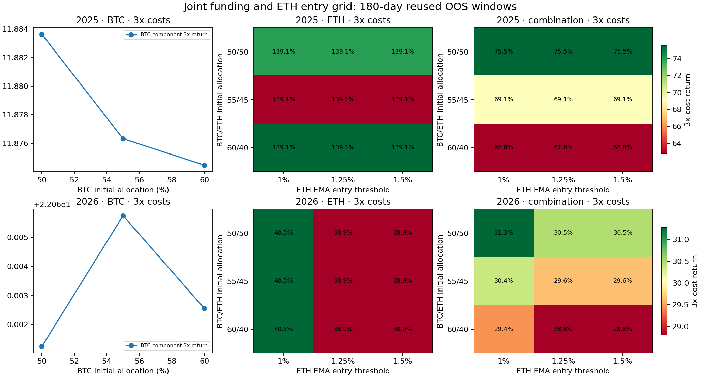

# 资金分配与 ETH 入场阈值联合研究

轮次：`20261012T015432Z`；冻结时间：`2026-10-12T02:11:25.543914Z`。

## 结论

实际计算并独立审计了 28 个新配置（16 个单币组件、12 个组合），每个配置均有 1x/2x/3x 成本结果。成本后 1x 和 3x 均为正的配置数分别为 **28/28**、**28/28**；按冻结八项门槛 **18 个 passed，10 个 rejected**。passed 表示复用历史上的筛选结果，不代表未触碰测试集、实盘收益或稳定盈利。

BTC 独立组件四个新资金规模变体均因 1x 六折中仅 2–3 折为正、未达到至少 4 折而 rejected；ETH 2026 六个单组件变体因同一折数门槛 rejected。其余 18 个 ETH 2025/组合配置达到当前所有门槛。没有配置因负收益而被移除；所有记录均写回 registry。

重点是 **BTC/ETH 50/50 初始分仓**（各 1000 USDT）及 ETH EMA34 上破 1.25%/下破 0.5% 的组合。两段历史 1x 净收益分别为 77.95% 与 31.86%，3x 分别为 75.51% 与 30.48%；完整分钟采样净值最大回撤分别为 13.72% 与 9.70%。BTC 60/40 配置也通过，但回报较低。这里沿用已重复研究的历史，属于开发/验证证据，不是独立最终留出。

## 研究设计与信号

组合总初始本金固定 2000 USDT，原始权重不归一化、不调仓、不跨资产转账：BTC 初始权重 50%/55%/60%，ETH 为互补 50%/45%/40%，每个变更资金规模均重新执行 Decimal 成交核算。ETH 只测 EMA34 入场阈值 1.00%/1.25%/1.50%，退出 0.50% 固定；BTC 规则冻结为收盘通道 15/30、EMA15 入场 1%/退出 3%、前 40 个完整 UTC 日 quote-volume 均值的 1.1 倍入口确认。信号只用前一已闭合日收盘，通道窗口排除被比较收盘，EMA 以首日 close 起始、`adjust=False` 递推。退出优先，未满足条件时保持状态。

## Walk-forward 与成本

六个连续 30 日折采用 180 日滚动历史、3 日 embargo、无拟合/标签，参数和信号保持冻结。

|数据窗口|OOS 起始成交|终止成本平仓|
|---|---|---|
|2025|2025-03-18T00:01:00Z|2025-09-14T00:01:00Z|
|2026|2026-03-18T00:01:00Z|2026-09-14T00:01:00Z|

成本按每侧手续费 0.10%、半价差 0.01%、滑点 0.02% 与 0.5×前20日样本波动率×sqrt(预算/前20日 quote ADV)冲击；参与率上限 0.10%；所有成本项同倍数压力放大，成交数量遵守 PRICE_FILTER、LOT_SIZE、NOTIONAL、百分比价格过滤和 Decimal tick/step 舍入。规则元数据为冻结的 2026-10-01 快照，应用于 2025 数据只是压力假设，并非当年交易所规则。半价差已体现在模拟执行价，未重复扣除。现货只做多，无资金费或借币。

本轮处理 **84 个新成本场景、21,788,088 个分钟净值点**。独立核验重新计算 8640 个日线信号决定和 216 个新虚拟成交，检查资金、数量、舍入、费用、折线和净值。没有下真实订单。完整净值逐点最大回撤分别是分钟采样口径与日末采样口径，未外推为未保存分钟之间或实盘级回撤。

## 全部新配置（按 1x 净收益降序）

|窗口|配置|原始权重 BTC/ETH|ETH入场|1x净收益|2x净收益|3x净收益|3x回撤|1x费用|1x来回次数|正收益折数|状态|未通过门槛|
|---|---|---:|---:|---:|---:|---:|---:|---:|---:|---:|---|---|
|2025|budgeteth_2025_btc0.6_e0.01_c800|60%/40%|1.00%|141.68%|140.39%|139.14%|20.25%|6.42|2|5/6|passed|—|
|2025|budgeteth_2025_btc0.6_e0.0125_c800|60%/40%|1.25%|141.68%|140.39%|139.14%|20.25%|6.42|2|5/6|passed|—|
|2025|budgeteth_2025_btc0.6_e0.015_c800|60%/40%|1.50%|141.68%|140.39%|139.14%|20.25%|6.42|2|5/6|passed|—|
|2025|budgeteth_2025_btc0.5_e0.01_c1000|50%/50%|1.00%|141.68%|140.39%|139.13%|20.25%|8.03|2|5/6|passed|—|
|2025|budgeteth_2025_btc0.5_e0.0125_c1000|50%/50%|1.25%|141.68%|140.39%|139.13%|20.25%|8.03|2|5/6|passed|—|
|2025|budgeteth_2025_btc0.5_e0.015_c1000|50%/50%|1.50%|141.68%|140.39%|139.13%|20.25%|8.03|2|5/6|passed|—|
|2025|budgetcombo_2025_btc0.5_eth0.5_e0.01|50%/50%|1.00%|77.95%|76.73%|75.51%|13.72%|19.93|6|4/6|passed|—|
|2025|budgetcombo_2025_btc0.5_eth0.5_e0.0125|50%/50%|1.25%|77.95%|76.73%|75.51%|13.72%|19.93|6|4/6|passed|—|
|2025|budgetcombo_2025_btc0.5_eth0.5_e0.015|50%/50%|1.50%|77.95%|76.73%|75.51%|13.72%|19.93|6|4/6|passed|—|
|2025|budgetcombo_2025_btc0.6_eth0.4_e0.01|60%/40%|1.00%|65.22%|63.99%|62.78%|13.23%|20.70|6|4/6|passed|—|
|2025|budgetcombo_2025_btc0.6_eth0.4_e0.0125|60%/40%|1.25%|65.22%|63.99%|62.78%|13.23%|20.70|6|4/6|passed|—|
|2025|budgetcombo_2025_btc0.6_eth0.4_e0.015|60%/40%|1.50%|65.22%|63.99%|62.78%|13.23%|20.70|6|4/6|passed|—|
|2026|budgeteth_2026_btc0.6_e0.01_c800|60%/40%|1.00%|42.00%|41.25%|40.51%|10.69%|4.67|2|3/6|rejected|four_positive_1x_folds|
|2026|budgeteth_2026_btc0.5_e0.01_c1000|50%/50%|1.00%|41.99%|41.25%|40.51%|10.69%|5.85|2|3/6|rejected|four_positive_1x_folds|
|2026|budgeteth_2026_btc0.5_e0.0125_c1000|50%/50%|1.25%|40.38%|39.63%|38.90%|11.71%|5.83|2|3/6|rejected|four_positive_1x_folds|
|2026|budgeteth_2026_btc0.5_e0.015_c1000|50%/50%|1.50%|40.38%|39.63%|38.90%|11.71%|5.83|2|3/6|rejected|four_positive_1x_folds|
|2026|budgeteth_2026_btc0.6_e0.0125_c800|60%/40%|1.25%|40.37%|39.64%|38.91%|11.71%|4.66|2|3/6|rejected|four_positive_1x_folds|
|2026|budgeteth_2026_btc0.6_e0.015_c800|60%/40%|1.50%|40.37%|39.64%|38.91%|11.71%|4.66|2|3/6|rejected|four_positive_1x_folds|
|2026|budgetcombo_2026_btc0.5_eth0.5_e0.01|50%/50%|1.00%|32.67%|31.98%|31.29%|9.20%|11.52|4|4/6|passed|—|
|2026|budgetcombo_2026_btc0.5_eth0.5_e0.0125|50%/50%|1.25%|31.86%|31.17%|30.48%|9.70%|11.49|4|4/6|passed|—|
|2026|budgetcombo_2026_btc0.5_eth0.5_e0.015|50%/50%|1.50%|31.86%|31.17%|30.48%|9.70%|11.49|4|4/6|passed|—|
|2026|budgetcombo_2026_btc0.6_eth0.4_e0.01|60%/40%|1.00%|30.81%|30.13%|29.44%|9.67%|11.47|4|4/6|passed|—|
|2026|budgetcombo_2026_btc0.6_eth0.4_e0.0125|60%/40%|1.25%|30.15%|29.48%|28.80%|10.09%|11.46|4|4/6|passed|—|
|2026|budgetcombo_2026_btc0.6_eth0.4_e0.015|60%/40%|1.50%|30.15%|29.48%|28.80%|10.09%|11.46|4|4/6|passed|—|
|2026|budgetbtc_2026_w0.5|50%/50%|—|23.35%|22.71%|22.06%|13.34%|5.66|2|3/6|rejected|four_positive_1x_folds|
|2026|budgetbtc_2026_w0.6|60%/40%|—|23.35%|22.71%|22.06%|13.34%|6.80|2|3/6|rejected|four_positive_1x_folds|
|2025|budgetbtc_2025_w0.6|60%/40%|—|14.24%|13.05%|11.87%|15.18%|14.28|4|2/6|rejected|four_positive_1x_folds|
|2025|budgetbtc_2025_w0.5|50%/50%|—|14.23%|13.06%|11.88%|15.18%|11.89|4|2/6|rejected|four_positive_1x_folds|



图中 BTC 面板显示单资产资金权重变化；ETH 与组合面板显示 BTC/ETH 初始权重 × ETH EMA 入场阈值的网格。所有面板均为描述性敏感性结果，历史相互重叠/反复使用，不能把局部平台解释为统计独立或未来稳定性。

每个配置和 1x/2x/3x 场景的六折净收益、逐折回撤/Sharpe/Calmar/成本明细见 [`folds.csv`](folds.csv)；报告 JSON 同时保存连续全 OOS 分钟净值统计和完整折线。

## 敏感性、比较和局限

- `2025_BTC`：3 个格点，3x 正收益比例 100%，3x Sharpe 正比例 100%，回报范围 11.87% 至 11.88%；相邻格点数 2。
- `2025_ETH`：9 个格点，3x 正收益比例 100%，3x Sharpe 正比例 100%，回报范围 139.13% 至 139.14%；相邻格点数 12。
- `2025_combination`：9 个格点，3x 正收益比例 100%，3x Sharpe 正比例 100%，回报范围 62.78% 至 75.51%；相邻格点数 12。
- `2026_BTC`：3 个格点，3x 正收益比例 100%，3x Sharpe 正比例 100%，回报范围 22.06% 至 22.07%；相邻格点数 2。
- `2026_ETH`：9 个格点，3x 正收益比例 100%，3x Sharpe 正比例 100%，回报范围 38.90% 至 40.52%；相邻格点数 12。
- `2026_combination`：9 个格点，3x 正收益比例 100%，3x Sharpe 正比例 100%，回报范围 28.80% 至 31.29%；相邻格点数 12。

全部新分钟净值中有 24 条在既往结果报告中出现过完全相同 SHA，60 条为首次出现；这不撤销参数/资金配置的独立登记，但明确显示两段历史与组件轨迹存在重用。来源扫描覆盖 4080 条既往独立净值路径。

既往多重尝试：本研究开始前的规范策略条目数 3953，另存在本文档所示的历史轮次；2025–2026 研究区间曾被反复使用。当前模型没有独立未触碰最终留出，因此仅作历史验证，不宣称统计确认。数据使用已有 UTC 现货分钟档案、每日聚合输入和交易所过滤器假设，不下载新行情。

旧 SMA65 延迟 shadow 的 2026-10-12 00:01 UTC 决策已错过；没有用历史分钟开盘补做订单，源 shadow 状态和报告 SHA 保持不变。该 gap 留档于 `legacy_shadow_gap.json`。十组 paper10 账户/资金/持仓属于单独任务，本研究不读取它们来做候选排名，也未改变其状态。

## 复现与证据

```bash
./.venv/bin/python research/experiments/20261012T015432Z/evaluate.py
./.venv/bin/python research/experiments/20261012T015432Z/audit.py
./.venv/bin/python research/experiments/20261012T015432Z/evaluate.py --reproduce
./.venv/bin/python research/experiments/20261012T015432Z/history_paths.py
python3 research/automation/registry.py finish <each spec> <passed|rejected> research/experiments/20261012T015432Z/report.json
```

财务报告 SHA256：`33c47eeb0990c06d2f884313867d20f642098316c0e66170232c00c0f88d5ed0`；独立审计确认 28 个实际配置的 1/2/3x 结果并与每个预先 reserve 的 spec 绑定。原始数据 SHA256 和全部组件/源规则版本见 `report.json`、`data_manifest.json`、`specs/`。

正收益仅代表指定历史与执行成本假设下的回测观察，不构成真实订单成交或稳定实盘盈利保证。
