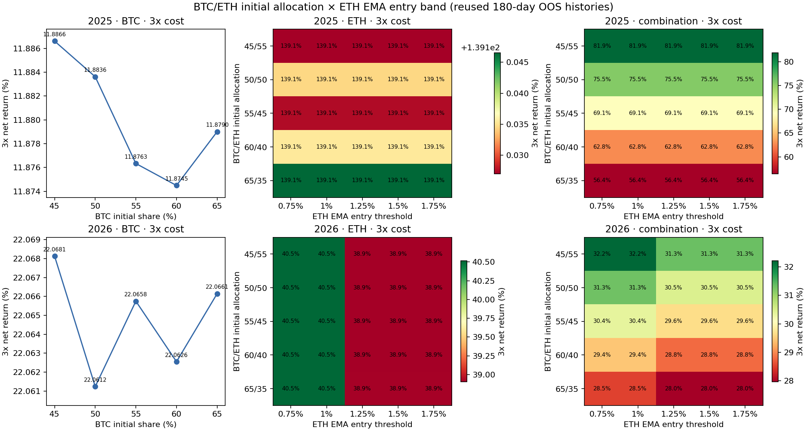

# BTC/ETH 初始分仓 × ETH EMA 入场阈值网格研究

轮次 `20261012T035429Z`；触发 `2026-10-12T03:54:29.198Z`，冻结 `2026-10-12T04:04:41.557357+00:00`。每个组合初始总资金 2000 USDT，固定初始分仓。

## 结论

预先 reserve 后实际评估 **68 个新配置**（36 个组件、32 个组合），每个运行 1x/2x/3x 成本，共 **204 个新成本场景**。1x、3x 净收益为正的数量均为 **68/68**。冻结八项门槛下 **43 个 passed、25 个 rejected**；全部结果和失败门槛都保留。`passed` 仅表示在重复使用历史上通过当前规则筛选，不是独立最终留出或稳定实盘盈利。

25 个 rejected 配置都因六折 1x 正收益折数少于 4/6；没有因 1x/2x/3x 累计净收益为负、最大回撤超限或账务不平而淘汰。新 BTC 组件4个全部折数不足；2026 ETH单组件16个折数不足；2025 ETH单组件16个通过；2025组合11/16通过，2026组合16/16通过。

组合结果中，BTC45%/ETH55%配置在两段历史的5档ETH入场阈值上均满足冻结门槛；BTC65%/ETH35%在两段历史上的3x总收益仍为正，但2025仅3/6盈利折，组合淘汰。结果说明比例会影响跨折一致性，不能只看累计净值。

## 冻结方向与资金含义

BTC 收盘通道15日入场/30日退出，加 EMA15 入场1%/退出3%，前40个完整UTC日USDT quote成交额至少为均值1.1倍才入场，退出不受成交额限制；规则保持不变。ETH为收盘通道15/30与递归 EMA34 联合入场，入场阈值0.75%、1.00%、1.25%、1.50%、1.75%，退出阈值固定0.50%。信号用前一闭合日收盘；通道窗口明确排除被比较收盘，EMA首值为全样本首日close、`adjust=False`递推。

组合原始初始比例BTC45/50/55/60/65%，ETH按Decimal精确互补55/50/45/40/35%，每个组合合计2000 USDT。对应BTC/ETH初始现金为900/1100、1000/1000、1100/900、1200/800、1300/700 USDT。无归一化、调仓或策略间转账；更改资金规模的组件按新的现金预算重新模拟成交和冲击成本。

重点对照BTC50/ETH50、ETH入场1.25%在结果前声明，属于R48已完成配置的只读复用，不计新变体。新格网是两个预设维度，不根据格网结果修改规则或挑选新前向参数。

## Walk-forward 与成本

两个六折窗口沿用 2025-03-18 至 2025-09-14、2026-03-18 至 2026-09-14 的180日OOS，折为连续30天、180日滚动上下文、3日embargo，无模型拟合/标签。历史已多次用于开发/验证，不能称未触碰最终测试集。全部新变体的六折净收益、逐折回撤、Sharpe、Calmar与成交成本在 [`folds.csv`](folds.csv)；完整连续OOS分钟净值风险统计和每变体成本结果在 `report.json`、`sensitivity.csv`。最大回撤采用完整回测分钟净值采样，不外推到未保存的分钟之间。

成本模型每侧手续费10bp、半价差1bp、滑点2bp及0.5×过去20个完整日样本波动率×sqrt(订单预算/过去20日quote ADV)冲击，参与率上限0.1%；全部成本项按1x/2x/3x同时放大。遵守 frozen PRICE_FILTER、LOT_SIZE、NOTIONAL、百分比价格规则与Decimal tick/step舍入。2026-10-01交易所规则快照用于2025价位只是压力假设。现货只做多，无借币/资金费，无真实IOC接单证明。新回测共204场景、52,913,928分钟NAV点、456个新组件成本场景成交。



图与表为历史敏感性/回测结果，不是统计显著性检验；路径有复用，多重尝试会使筛选收益偏乐观。旧SMA65延迟shadow仍是blocked_no_backfill，不将错过决策回写；独立paper10账户plan/资金/持仓未改。

## 全部新配置（按1x累计净收益降序）

|窗口|配置|BTC/ETH初始比例|ETH入场|1x收益|2x收益|3x收益|3x回撤|1x成本|1x来回次数|盈利折|状态|淘汰原因|
|---|---|---:|---:|---:|---:|---:|---:|---:|---:|---:|---|---|
|2025|budgeteth_2025_btc0.6_entry0.0075_c800|60%/40%|0.75%|141.68%|140.39%|139.14%|20.25%|6.42|2|5/6|passed|—|
|2025|budgeteth_2025_btc0.6_entry0.0175_c800|60%/40%|1.75%|141.68%|140.39%|139.14%|20.25%|6.42|2|5/6|passed|—|
|2025|budgeteth_2025_btc0.5_entry0.0075_c1000|50%/50%|0.75%|141.68%|140.39%|139.13%|20.25%|8.03|2|5/6|passed|—|
|2025|budgeteth_2025_btc0.5_entry0.0175_c1000|50%/50%|1.75%|141.68%|140.39%|139.13%|20.25%|8.03|2|5/6|passed|—|
|2025|budgeteth_2025_btc0.55_entry0.0075_c900|55%/45%|0.75%|141.66%|140.40%|139.13%|20.25%|7.23|2|5/6|passed|—|
|2025|budgeteth_2025_btc0.55_entry0.0175_c900|55%/45%|1.75%|141.66%|140.40%|139.13%|20.25%|7.23|2|5/6|passed|—|
|2025|budgeteth_2025_btc0.45_entry0.0075_c1100|45%/55%|0.75%|141.66%|140.40%|139.13%|20.25%|8.84|2|5/6|passed|—|
|2025|budgeteth_2025_btc0.45_entry0.01_c1100|45%/55%|1.00%|141.66%|140.40%|139.13%|20.25%|8.84|2|5/6|passed|—|
|2025|budgeteth_2025_btc0.45_entry0.0125_c1100|45%/55%|1.25%|141.66%|140.40%|139.13%|20.25%|8.84|2|5/6|passed|—|
|2025|budgeteth_2025_btc0.45_entry0.015_c1100|45%/55%|1.50%|141.66%|140.40%|139.13%|20.25%|8.84|2|5/6|passed|—|
|2025|budgeteth_2025_btc0.45_entry0.0175_c1100|45%/55%|1.75%|141.66%|140.40%|139.13%|20.25%|8.84|2|5/6|passed|—|
|2025|budgeteth_2025_btc0.65_entry0.0075_c700|65%/35%|0.75%|141.66%|140.40%|139.15%|20.25%|5.61|2|5/6|passed|—|
|2025|budgeteth_2025_btc0.65_entry0.01_c700|65%/35%|1.00%|141.66%|140.40%|139.15%|20.25%|5.61|2|5/6|passed|—|
|2025|budgeteth_2025_btc0.65_entry0.0125_c700|65%/35%|1.25%|141.66%|140.40%|139.15%|20.25%|5.61|2|5/6|passed|—|
|2025|budgeteth_2025_btc0.65_entry0.015_c700|65%/35%|1.50%|141.66%|140.40%|139.15%|20.25%|5.61|2|5/6|passed|—|
|2025|budgeteth_2025_btc0.65_entry0.0175_c700|65%/35%|1.75%|141.66%|140.40%|139.15%|20.25%|5.61|2|5/6|passed|—|
|2025|budgetcombo_2025_BTC0.45_ETH0.55_entry0.0075|45%/55%|0.75%|84.32%|83.09%|81.87%|13.96%|19.54|6|4/6|passed|—|
|2025|budgetcombo_2025_BTC0.45_ETH0.55_entry0.01|45%/55%|1.00%|84.32%|83.09%|81.87%|13.96%|19.54|6|4/6|passed|—|
|2025|budgetcombo_2025_BTC0.45_ETH0.55_entry0.0125|45%/55%|1.25%|84.32%|83.09%|81.87%|13.96%|19.54|6|4/6|passed|—|
|2025|budgetcombo_2025_BTC0.45_ETH0.55_entry0.015|45%/55%|1.50%|84.32%|83.09%|81.87%|13.96%|19.54|6|4/6|passed|—|
|2025|budgetcombo_2025_BTC0.45_ETH0.55_entry0.0175|45%/55%|1.75%|84.32%|83.09%|81.87%|13.96%|19.54|6|4/6|passed|—|
|2025|budgetcombo_2025_BTC0.5_ETH0.5_entry0.0075|50%/50%|0.75%|77.95%|76.73%|75.51%|13.72%|19.93|6|4/6|passed|—|
|2025|budgetcombo_2025_BTC0.5_ETH0.5_entry0.0175|50%/50%|1.75%|77.95%|76.73%|75.51%|13.72%|19.93|6|4/6|passed|—|
|2025|budgetcombo_2025_BTC0.55_ETH0.45_entry0.0075|55%/45%|0.75%|71.58%|70.36%|69.14%|13.48%|20.32|6|4/6|passed|—|
|2025|budgetcombo_2025_BTC0.55_ETH0.45_entry0.0175|55%/45%|1.75%|71.58%|70.36%|69.14%|13.48%|20.32|6|4/6|passed|—|
|2025|budgetcombo_2025_BTC0.6_ETH0.4_entry0.0075|60%/40%|0.75%|65.22%|63.99%|62.78%|13.23%|20.70|6|4/6|passed|—|
|2025|budgetcombo_2025_BTC0.6_ETH0.4_entry0.0175|60%/40%|1.75%|65.22%|63.99%|62.78%|13.23%|20.70|6|4/6|passed|—|
|2025|budgetcombo_2025_BTC0.65_ETH0.35_entry0.0075|65%/35%|0.75%|58.84%|57.62%|56.42%|12.98%|21.09|6|3/6|rejected|four_positive_1x_folds|
|2025|budgetcombo_2025_BTC0.65_ETH0.35_entry0.01|65%/35%|1.00%|58.84%|57.62%|56.42%|12.98%|21.09|6|3/6|rejected|four_positive_1x_folds|
|2025|budgetcombo_2025_BTC0.65_ETH0.35_entry0.0125|65%/35%|1.25%|58.84%|57.62%|56.42%|12.98%|21.09|6|3/6|rejected|four_positive_1x_folds|
|2025|budgetcombo_2025_BTC0.65_ETH0.35_entry0.015|65%/35%|1.50%|58.84%|57.62%|56.42%|12.98%|21.09|6|3/6|rejected|four_positive_1x_folds|
|2025|budgetcombo_2025_BTC0.65_ETH0.35_entry0.0175|65%/35%|1.75%|58.84%|57.62%|56.42%|12.98%|21.09|6|3/6|rejected|four_positive_1x_folds|
|2026|budgeteth_2026_btc0.45_entry0.0075_c1100|45%/55%|0.75%|42.00%|41.25%|40.51%|10.69%|6.44|2|3/6|rejected|four_positive_1x_folds|
|2026|budgeteth_2026_btc0.45_entry0.01_c1100|45%/55%|1.00%|42.00%|41.25%|40.51%|10.69%|6.44|2|3/6|rejected|four_positive_1x_folds|
|2026|budgeteth_2026_btc0.65_entry0.0075_c700|65%/35%|0.75%|42.00%|41.25%|40.51%|10.68%|4.09|2|3/6|rejected|four_positive_1x_folds|
|2026|budgeteth_2026_btc0.65_entry0.01_c700|65%/35%|1.00%|42.00%|41.25%|40.51%|10.68%|4.09|2|3/6|rejected|four_positive_1x_folds|
|2026|budgeteth_2026_btc0.6_entry0.0075_c800|60%/40%|0.75%|42.00%|41.25%|40.51%|10.69%|4.67|2|3/6|rejected|four_positive_1x_folds|
|2026|budgeteth_2026_btc0.55_entry0.0075_c900|55%/45%|0.75%|42.00%|41.25%|40.52%|10.69%|5.27|2|3/6|rejected|four_positive_1x_folds|
|2026|budgeteth_2026_btc0.5_entry0.0075_c1000|50%/50%|0.75%|41.99%|41.25%|40.51%|10.69%|5.85|2|3/6|rejected|four_positive_1x_folds|
|2026|budgeteth_2026_btc0.5_entry0.0175_c1000|50%/50%|1.75%|40.38%|39.63%|38.90%|11.71%|5.83|2|3/6|rejected|four_positive_1x_folds|
|2026|budgeteth_2026_btc0.65_entry0.0125_c700|65%/35%|1.25%|40.37%|39.63%|38.91%|11.71%|4.08|2|3/6|rejected|four_positive_1x_folds|
|2026|budgeteth_2026_btc0.65_entry0.015_c700|65%/35%|1.50%|40.37%|39.63%|38.91%|11.71%|4.08|2|3/6|rejected|four_positive_1x_folds|
|2026|budgeteth_2026_btc0.65_entry0.0175_c700|65%/35%|1.75%|40.37%|39.63%|38.91%|11.71%|4.08|2|3/6|rejected|four_positive_1x_folds|
|2026|budgeteth_2026_btc0.55_entry0.0175_c900|55%/45%|1.75%|40.37%|39.64%|38.91%|11.71%|5.25|2|3/6|rejected|four_positive_1x_folds|
|2026|budgeteth_2026_btc0.45_entry0.0125_c1100|45%/55%|1.25%|40.37%|39.64%|38.90%|11.71%|6.41|2|3/6|rejected|four_positive_1x_folds|
|2026|budgeteth_2026_btc0.45_entry0.015_c1100|45%/55%|1.50%|40.37%|39.64%|38.90%|11.71%|6.41|2|3/6|rejected|four_positive_1x_folds|
|2026|budgeteth_2026_btc0.45_entry0.0175_c1100|45%/55%|1.75%|40.37%|39.64%|38.90%|11.71%|6.41|2|3/6|rejected|four_positive_1x_folds|
|2026|budgeteth_2026_btc0.6_entry0.0175_c800|60%/40%|1.75%|40.37%|39.64%|38.91%|11.71%|4.66|2|3/6|rejected|four_positive_1x_folds|
|2026|budgetcombo_2026_BTC0.45_ETH0.55_entry0.0075|45%/55%|0.75%|33.61%|32.91%|32.21%|9.20%|11.53|4|4/6|passed|—|
|2026|budgetcombo_2026_BTC0.45_ETH0.55_entry0.01|45%/55%|1.00%|33.61%|32.91%|32.21%|9.20%|11.53|4|4/6|passed|—|
|2026|budgetcombo_2026_BTC0.45_ETH0.55_entry0.0125|45%/55%|1.25%|32.71%|32.02%|31.33%|9.76%|11.50|4|4/6|passed|—|
|2026|budgetcombo_2026_BTC0.45_ETH0.55_entry0.015|45%/55%|1.50%|32.71%|32.02%|31.33%|9.76%|11.50|4|4/6|passed|—|
|2026|budgetcombo_2026_BTC0.45_ETH0.55_entry0.0175|45%/55%|1.75%|32.71%|32.02%|31.33%|9.76%|11.50|4|4/6|passed|—|
|2026|budgetcombo_2026_BTC0.5_ETH0.5_entry0.0075|50%/50%|0.75%|32.67%|31.98%|31.29%|9.20%|11.52|4|4/6|passed|—|
|2026|budgetcombo_2026_BTC0.5_ETH0.5_entry0.0175|50%/50%|1.75%|31.86%|31.17%|30.48%|9.70%|11.49|4|4/6|passed|—|
|2026|budgetcombo_2026_BTC0.55_ETH0.45_entry0.0075|55%/45%|0.75%|31.74%|31.05%|30.37%|9.24%|11.50|4|4/6|passed|—|
|2026|budgetcombo_2026_BTC0.55_ETH0.45_entry0.0175|55%/45%|1.75%|31.01%|30.33%|29.64%|9.72%|11.47|4|4/6|passed|—|
|2026|budgetcombo_2026_BTC0.6_ETH0.4_entry0.0075|60%/40%|0.75%|30.81%|30.13%|29.44%|9.67%|11.47|4|4/6|passed|—|
|2026|budgetcombo_2026_BTC0.6_ETH0.4_entry0.0175|60%/40%|1.75%|30.15%|29.48%|28.80%|10.09%|11.46|4|4/6|passed|—|
|2026|budgetcombo_2026_BTC0.65_ETH0.35_entry0.0075|65%/35%|0.75%|29.88%|29.20%|28.52%|10.09%|11.46|4|4/6|passed|—|
|2026|budgetcombo_2026_BTC0.65_ETH0.35_entry0.01|65%/35%|1.00%|29.88%|29.20%|28.52%|10.09%|11.46|4|4/6|passed|—|
|2026|budgetcombo_2026_BTC0.65_ETH0.35_entry0.0125|65%/35%|1.25%|29.31%|28.63%|27.96%|10.46%|11.44|4|4/6|passed|—|
|2026|budgetcombo_2026_BTC0.65_ETH0.35_entry0.015|65%/35%|1.50%|29.31%|28.63%|27.96%|10.46%|11.44|4|4/6|passed|—|
|2026|budgetcombo_2026_BTC0.65_ETH0.35_entry0.0175|65%/35%|1.75%|29.31%|28.63%|27.96%|10.46%|11.44|4|4/6|passed|—|
|2026|budgetbtc_2026_0.65|65%/35%|—|23.35%|22.71%|22.07%|13.34%|7.37|2|3/6|rejected|four_positive_1x_folds|
|2026|budgetbtc_2026_0.45|45%/55%|—|23.35%|22.71%|22.07%|13.35%|5.09|2|3/6|rejected|four_positive_1x_folds|
|2025|budgetbtc_2025_0.65|65%/35%|—|14.24%|13.05%|11.88%|15.18%|15.47|4|2/6|rejected|four_positive_1x_folds|
|2025|budgetbtc_2025_0.45|45%/55%|—|14.23%|13.05%|11.89%|15.18%|10.70|4|2/6|rejected|four_positive_1x_folds|

## 敏感性、查重与复现

- `2025_BTC`：5格；3x正收益比例100%，Sharpe为正比例100%，回报范围11.87%至11.89%；相邻网格边4。
- `2025_ETH`：25格；3x正收益比例100%，Sharpe为正比例100%，回报范围139.13%至139.15%；相邻网格边40。
- `2025_combination`：25格；3x正收益比例100%，Sharpe为正比例100%，回报范围56.42%至81.87%；相邻网格边40。
- `2026_BTC`：5格；3x正收益比例100%，Sharpe为正比例100%，回报范围22.06%至22.07%；相邻网格边4。
- `2026_ETH`：25格；3x正收益比例100%，Sharpe为正比例100%，回报范围38.90%至40.52%；相邻网格边40。
- `2026_combination`：25格；3x正收益比例100%，Sharpe为正比例100%，回报范围27.96%至32.21%；相邻网格边40。

既往注册规范定义 4011 项；本轮新定义68项，另42项精确配置及126个历史成本场景只读复用。前次全历史SHA检查找到 111 条未在任何既往报告中完整出现的新分钟NAV路径；新参数/分仓仍不代表独立市场样本。

原16项配置已有真实结果，无缺项。已有数据仅供重复研究历史验证，结果不能宣称稳定实盘盈利。

预冻结运行命令：

```bash
./.venv/bin/python research/experiments/20261012T035429Z/check_signals.py
./.venv/bin/python research/experiments/20261012T035429Z/restore_cache.py
./.venv/bin/python research/experiments/20261012T035429Z/evaluate.py
./.venv/bin/python research/experiments/20261012T035429Z/audit.py
./.venv/bin/python research/experiments/20261012T035429Z/evaluate.py --reproduce
./.venv/bin/python research/experiments/20261012T035429Z/history_paths.py
./.venv/bin/python research/experiments/20261012T035429Z/check_batch.py
./.venv/bin/python research/experiments/20261012T035429Z/finish.py
python3 checks/strategy_registry.py
```

report SHA256：`383d833e5d7d9d12aac3dacdb02051fdd2a0b3b4b49c0e099ddc1b38c3c7e16e`。所有68个新spec均在计算前 reserve，实际1x/2x/3x回测后独立 finish。post-freeze兼容性修订及其范围见 `post_freeze_engineering_recovery.json`；参数、计划、预算、规则、登记指纹均未修改。
