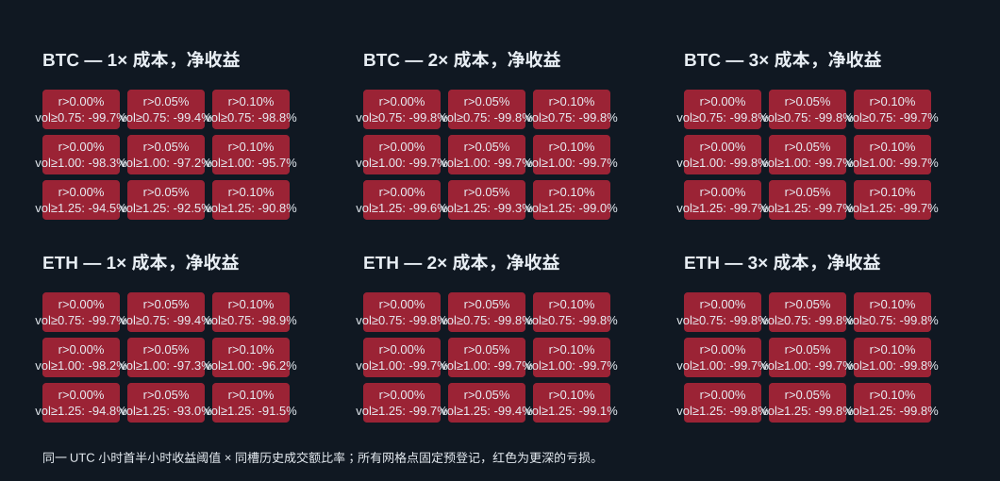

# 半小时动量延续研究 — 20261013T052946Z

## 结论

按预登记配置对 BTC/ETH 现货 UTC 小时首半小时动量与同槽成交额过滤做了 360 天历史验证。18 个候选全部 rejected；1×/2×/3×成本下均未有正收益的配置。最好的 1×结果仍分别亏损约 90.8%（BTC）和 91.5%（ETH），所有候选的 1× 12 折里正收益折数均为 0。该方向按冻结失败门槛淘汰，不进入 paper10，也不构成任何实盘盈利结论。

研究动机来自 Shen、Urquhart 与 Wang 对比特币日内时间序列动量的研究：论文报告首半小时对末半小时有预测关系，并提到高成交量/高波动时段更强。本次 UTC 小时首半小时、BTC/ETH、现货成本设置是事先定义的独立适配测试，不是论文复现或论文结论的再验证。[论文 DOI](https://doi.org/10.1111/fire.12290)

## 预登记规则与验证范围

- 每个独立 2,000 USDT 现货账户只做多，不加仓、不借贷、不跨币转账。18 个候选由两币 × 首半小时收益阈值 `{0, 0.05%, 0.10%}` × 同 UTC 小时前 20 个完整日首半小时成交额比率 `{0.75, 1.00, 1.25}` 组成；另有 BTC/ETH 两个买入持有对照。所有 20 个 fingerprint 均在计算前独立 reserve。
- 信号在 UTC 小时 H 的 00–29 分钟闭合后可得：`close(H+29)/open(H)-1`。过滤比率只用当前时段之前 20 个完整 UTC 日的同一小时首半小时 quote volume，不含当前日。信号出现后 60 秒，在 H+31 的一分钟开盘虚拟成交；全平仓定于 H+61 开盘，约 30 分钟持有。拒绝的退出每分钟开盘重试，持仓时跳过新信号。没有使用成交持有区间的数据生成入场条件。
- 数据为仓库 Binance 现货一分钟历史，UTC 边界 2024-09-16 至 2026-09-16；warm-up 365 天，OOS 2025-09-19 至 2026-09-14（终端执行 00:01），12 个连续、不重叠的 30 天测试折。没有参数拟合。该仓库历史已反复用于研究，因此不是未触碰的最终留出集；存在多重尝试与样本选择偏差。
- 成本按每侧手续费 10bp、估计半价差 1bp、滑点 2bp，以及 `0.5 × 前 20 个完整 UTC 日收益标准差 × sqrt(订单 quote 金额 / 前 20 日 quote ADV)` 冲击计算；每项分别按 1×/2×/3× 放大。使用冻结 Binance 价格、数量、名义额与 percent-price filters，步长向下取整，且订单参与率不超过 lagged ADV 的 0.1%。没有历史 L2，因此价差、执行价格与冲击均为估计，不是实际成交。只做现货多头，funding/borrow 不适用。
- Walk-forward 用途是报告 12 个连续固定参数 OOS 时间块；敏感性使用预登记的 3×3 两参数网格及相邻网格 3×正收益比例；成本压力使用 1×/2×/3×。这些历史结果只是筛选，不代表可持续前向或实盘表现。

## 候选总表

按 1× 净收益降序。回撤是 OOS 一分钟收盘及成交后参考价采样回撤，不含分钟内极值。成本列为三档总成本；`拒单` 为 1×/2×/3×分别计数。

| 配置 | 资产 | 1×净收益 | 2×净收益 | 3×净收益 | 1×/3×回撤 | 1×往返 | 1×正折 | 邻居3×正比 | 1×/2×/3×成本 USDT | 拒单 1×/2×/3× | 状态 |
|---|---:|---:|---:|---:|---:|---:|---:|---:|---:|---:|---|
| `hhr_btc_ret10_vol125` | BTC | -90.78% | -98.95% | -99.75% | 90.79%/99.75% | 841 | 0/12 | 0.00% | 1,687.64/1,930.90/1,979.76 | 0/0/92 | **rejected** |
| `hhr_eth_ret10_vol125` | ETH | -91.51% | -99.13% | -99.75% | 91.59%/99.75% | 875 | 0/12 | 0.00% | 1,624.28/1,853.15/1,909.40 | 0/0/674 | **rejected** |
| `hhr_btc_ret05_vol125` | BTC | -92.50% | -99.30% | -99.75% | 92.61%/99.75% | 923 | 0/12 | 0.00% | 1,706.48/1,921.62/1,964.35 | 0/0/173 | **rejected** |
| `hhr_eth_ret05_vol125` | ETH | -93.04% | -99.41% | -99.75% | 93.06%/99.75% | 951 | 0/12 | 0.00% | 1,677.21/1,883.69/1,933.16 | 0/0/206 | **rejected** |
| `hhr_btc_ret00_vol125` | BTC | -94.52% | -99.61% | -99.75% | 94.61%/99.75% | 1032 | 0/12 | 0.00% | 1,723.94/1,913.07/1,952.09 | 0/0/286 | **rejected** |
| `hhr_eth_ret00_vol125` | ETH | -94.84% | -99.65% | -99.75% | 94.86%/99.80% | 1039 | 0/12 | 0.00% | 1,677.24/1,874.46/1,926.21 | 0/0/113046 | **rejected** |
| `hhr_btc_ret10_vol100` | BTC | -95.71% | -99.73% | -99.75% | 95.72%/99.75% | 1161 | 0/12 | 0.00% | 1,868.23/1,988.79/1,997.61 | 0/35/403 | **rejected** |
| `hhr_eth_ret10_vol100` | ETH | -96.15% | -99.75% | -99.75% | 96.15%/99.75% | 1186 | 0/12 | 0.00% | 1,794.81/1,931.49/1,958.36 | 0/617/458 | **rejected** |
| `hhr_btc_ret05_vol100` | BTC | -97.21% | -99.75% | -99.75% | 97.25%/99.75% | 1323 | 0/12 | 0.00% | 1,847.08/1,938.10/1,950.08 | 0/186/916 | **rejected** |
| `hhr_eth_ret05_vol100` | ETH | -97.30% | -99.75% | -99.75% | 97.30%/99.75% | 1312 | 0/12 | 0.00% | 1,812.92/1,935.41/1,966.47 | 0/239/1004 | **rejected** |
| `hhr_eth_ret00_vol100` | ETH | -98.21% | -99.75% | -99.75% | 98.21%/99.76% | 1443 | 0/12 | 0.00% | 1,799.24/1,916.99/1,952.80 | 0/377/1163 | **rejected** |
| `hhr_btc_ret00_vol100` | BTC | -98.34% | -99.75% | -99.75% | 98.36%/99.76% | 1502 | 0/12 | 0.00% | 1,850.10/1,927.05/1,940.50 | 0/436/7590 | **rejected** |
| `hhr_btc_ret10_vol075` | BTC | -98.80% | -99.75% | -99.75% | 98.80%/99.77% | 1615 | 0/12 | 0.00% | 1,926.03/1,996.45/2,005.11 | 0/495/7601 | **rejected** |
| `hhr_eth_ret10_vol075` | ETH | -98.95% | -99.75% | -99.75% | 98.95%/99.75% | 1664 | 0/12 | 0.00% | 1,844.94/1,919.18/1,937.58 | 0/556/987 | **rejected** |
| `hhr_btc_ret05_vol075` | BTC | -99.38% | -99.75% | -99.75% | 99.38%/99.75% | 1885 | 0/12 | 0.00% | 1,883.28/1,937.18/1,951.31 | 0/774/1314 | **rejected** |
| `hhr_eth_ret05_vol075` | ETH | -99.39% | -99.75% | -99.75% | 99.39%/99.75% | 1875 | 0/12 | 0.00% | 1,890.42/1,954.37/1,970.94 | 0/773/1137 | **rejected** |
| `hhr_eth_ret00_vol075` | ETH | -99.65% | -99.75% | -99.75% | 99.65%/99.75% | 2069 | 0/12 | 0.00% | 1,872.41/1,939.00/1,959.78 | 0/1129/1309 | **rejected** |
| `hhr_btc_ret00_vol075` | BTC | -99.72% | -99.75% | -99.75% | 99.72%/99.75% | 2181 | 0/12 | 0.00% | 1,892.47/1,939.43/1,953.24 | 0/8234/2163 | **rejected** |

## 对照与敏感性

| 对照配置 | 资产 | 1× / 2× / 3×净收益 | 最大采样回撤（1×） |
|---|---|---:|---:|
| `hold_360d_BTC_halfhour_period` | BTC | -34.47% / -34.54% / -34.63% | 54.10% |
| `hold_360d_ETH_halfhour_period` | ETH | -46.08% / -46.16% / -46.22% | 68.18% |



每个候选的全部 12 折、三档成本净收益、采样回撤、Sharpe 与 Calmar 保存于 [fold_results.csv](fold_results.csv)；54 行参数与成本敏感性数据在 [sensitivity.csv](sensitivity.csv)，60 个场景汇总在 [cost_scenarios.csv](cost_scenarios.csv)。完整逐笔交易账本、每日净值和逐分钟净值数组保存在本机忽略目录 `data/runs/20261013T052946Z/`，报告列出可复核的 SHA-256 与路径。

## 失败判据与审计

要求：三档成本净收益都为正；1×至少 8/12 折为正；3×采样回撤不超过 25%；相邻 3×网格正收益比例至少 60%；1×至少 250 次往返；毛参考 PnL/模型成本至少 2.5；无过滤器/容量/余额拒绝且终端空仓。18 个候选均未通过。虽然最好的若干配置有超过 250 次往返，但毛参考收益本身为负，无法覆盖成本；全候选 1× 正折为 0/12，相邻 3×正收益率为 0%，深度回撤远超 25%，3×还出现由最小名义额导致的拒单。负收益与拒单按完整实测结果保留，没有删除。

审计通过：60 个场景净值数组的 SHA 与长度、有限正值、现金/持仓非负、信号可得后执行、没有早于计划时点的卖出、拒单计数与逐笔账本对账、毛参考盈亏与成本恒等关系。逐分钟回撤只代表存档的分钟收盘/成交后采样，并非分钟内整体最大回撤。

## 复现和来源

运行顺序：

```bash
python3 research/experiments/20261013T052946Z/prepare.py
python3 research/experiments/20261013T052946Z/evaluate.py
python3 research/experiments/20261013T052946Z/audit.py
python3 research/experiments/20261013T052946Z/result.py
python3 research/experiments/20261013T052946Z/finish.py
```

主要输入 SHA-256：
- `data/normalized/binance/BTC/binance_BTC_20240916T000000Z_20250916T000000Z_transfer_20261001/spot_bars.parquet` — `9a5bc556eb277db34831457d22c53f50f5b4f2c0f04f6aefe80f941e51405ba6` (30555668 bytes, 525600 bars)
- `data/normalized/binance/BTC/binance_BTC_20250916T000000Z_20260916T000000Z_archive_20260929/spot_bars.parquet` — `50983b6865dc5873afa9c4e2abb2cf73d846ec5ed98b31453fee24afef1a0d16` (30415140 bytes, 525600 bars)
- `data/normalized/binance/ETH/binance_ETH_20240916T000000Z_20250916T000000Z_transfer_20261001/spot_bars.parquet` — `aaebd29868abe2ed3af3a6f3479b495e4d788385c1fb0988d5d2372a9be89d57` (27110682 bytes, 525600 bars)
- `data/normalized/binance/ETH/binance_ETH_20250916T000000Z_20260916T000000Z_archive_20260929/spot_bars.parquet` — `437545ee866153d6bf31a17a021b9249e5a97cb688cf60a42a58fc8515e83584` (26332430 bytes, 525600 bars)
- 执行 filters 源 `research/experiments/20261012T035429Z/report.json` — `383d833e5d7d9d12aac3dacdb02051fdd2a0b3b4b49c0e099ddc1b38c3c7e16e`
- 预登记执行器 `prepare.py` — `f710ddc137f5aa025d44ce5f09a508d6abdba2a0a9f88b6465e5192d795ede9a`
- 回测执行器 `evaluate.py` — `b45e85d7c41326b284e0b25e81476eef7e5d24c74d1576830c6d9407dde07dc6`

虚拟历史撮合不是交易所真实订单或实盘成交保证。本轮没有生成实盘成交，也没有修改十策略 paper10 账户。
