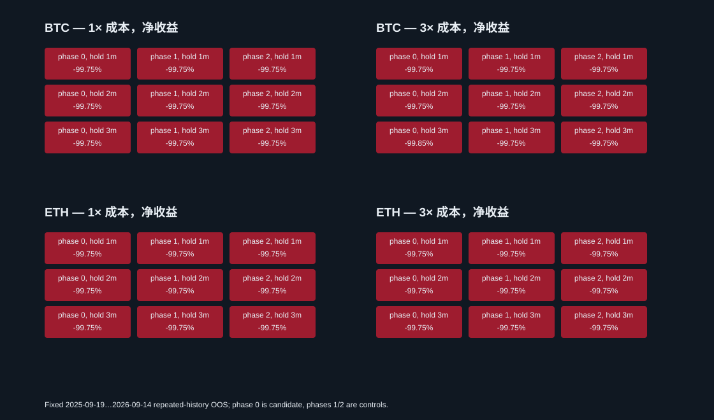

# UTC 15 分钟边界效应回测 — 20261013T073340Z

## 结论

恢复并实际计算此前仅登记后被标为 abandoned、没有回测结果的 20 个冻结定义（6 个 phase 0 候选、12 个 phase placebo、2 个买入持有对照）。6 个主要候选全部 **rejected**。1×/2×/3×成本净收益全为大幅负值，采样回撤约 99.75%；相位 placebo 也几乎相同，未呈现预设的 phase 0 优势。高频周转快速消耗现金后，大量入场因低于 Binance 最低名义额而拒绝；一项 3×情景还有不足最低名义额的残余仓位无法平仓。

研究动机来自 Shanaev 等人关于比特币 15 分钟 K 线边界收益的研究。原文策略的交易所费率档位与样本规模特殊；这里用仓库的 BTC/ETH Binance 分钟数据、每组 2,000 USDT 和冻结成本条件作独立可迁移性否证测试，不是论文复现，也不预设效应在 Binance 持续。[论文 DOI](https://doi.org/10.1016/j.heliyon.2023.e14236)

## 冻结规则与验证边界

- 规则：UTC 每小时分钟 `00/15/30/45` 的 K 线边界加固定相位 `0/1/2` 分钟，按预先已知日历在该分钟开盘买入；持有 `1/2/3` 分钟后在对应开盘全卖。事件之间空仓，不杠杆。所有价格均来自本次历史回测数据，仅作为该回测的历史成交参考；本轮没有真实订单，也没有把这些价格写入 paper10。
- 每个币种/相位/持有时长单独 2,000 USDT 账户：6 个 phase 0 候选、12 个相位 placebo；另保存 BTC 和 ETH 买入持有对照。20 项配置逐一成功 reserve 后才计算，并全部 finish。
- OOS：2025-09-19 至 2026-09-14，共 360 天、12 个连续 30 天折；从 2024-09-16 至 2026-09-16 的连续分钟数据暖机。策略没有拟合参数。该历史已被多次研究，不能称作未触碰最终留出集；结果也受到既往大量试验的多重比较影响。
- 成本：每侧手续费 10bp、估计半价差 1bp、滑点 2bp，以及 `0.5 × 前 20 个完整 UTC 日收益标准差 × sqrt(订单金额 / 前 20 日 quote ADV)` 冲击。三档成本同步放大。执行遵守冻结的 Binance PRICE_FILTER、LOT_SIZE、NOTIONAL 与 5 分钟成交量加权价代理过滤；最大参与率为前 20 日 quote ADV 的 0.1%。没有历史 L2，价差、滑点和冲击属于估计，非真实盘口或成交保证。只做现货多头，资金费/借币不适用。
- Walk-forward 报告逐折及连续事件/持仓分钟收盘采样净值；敏感性使用预登记的 phase × 持有时长 3×3 网格与相邻格；Costs 比较 1×/2×/3×。回撤不包含分钟内极值。

## 主要候选（按 1×净收益）

| 配置 | 币种 | phase | 持有 | 1×净收益 | 2×净收益 | 3×净收益 | 1×/3×回撤 | 1×往返 | 1×正折 | 邻近3×正比 | 1×成本USDT | 1×拒单 | 状态 |
|---|---:|---:|---:|---:|---:|---:|---:|---:|---:|---:|---:|---:|---|
| `turn15_btc_phase0_hold1m` | BTC | 0m | 1m | -99.750% | -99.750% | -99.750% | 99.750%/99.750% | 2353 | 0/12 | 0.000% | 1,990.29 | 32207 | **rejected** |
| `turn15_eth_phase0_hold3m` | ETH | 0m | 3m | -99.750% | -99.750% | -99.751% | 99.766%/99.751% | 2289 | 0/12 | 0.000% | 1,923.94 | 33927 | **rejected** |
| `turn15_eth_phase0_hold1m` | ETH | 0m | 1m | -99.750% | -99.750% | -99.750% | 99.750%/99.750% | 2303 | 0/12 | 0.000% | 1,965.62 | 32263 | **rejected** |
| `turn15_eth_phase0_hold2m` | ETH | 0m | 2m | -99.750% | -99.750% | -99.751% | 99.751%/99.751% | 2327 | 0/12 | 0.000% | 1,968.14 | 32254 | **rejected** |
| `turn15_btc_phase0_hold3m` | BTC | 0m | 3m | -99.750% | -99.750% | -99.846% | 99.754%/99.884% | 2316 | 0/12 | 0.000% | 1,963.09 | 33895 | **rejected** |
| `turn15_btc_phase0_hold2m` | BTC | 0m | 2m | -99.750% | -99.750% | -99.751% | 99.754%/99.751% | 2345 | 0/12 | 0.000% | 1,984.66 | 33867 | **rejected** |

## Placebo 与买入持有对照

| 配置 | 币种 | phase/持有 | 1×净收益 | 2×净收益 | 3×净收益 |
|---|---|---:|---:|---:|---:|
| `buy_hold_btc_event_period` | BTC | OOS 买入持有 | -34.534% | -34.689% | -34.863% |
| `buy_hold_eth_event_period` | ETH | OOS 买入持有 | -46.138% | -46.286% | -46.424% |
| `turn15_btc_phase1_hold1m` | BTC | phase 1m / 1m | -99.750% | -99.750% | -99.749% |
| `turn15_btc_phase1_hold2m` | BTC | phase 1m / 2m | -99.750% | -99.750% | -99.750% |
| `turn15_btc_phase1_hold3m` | BTC | phase 1m / 3m | -99.750% | -99.750% | -99.751% |
| `turn15_btc_phase2_hold1m` | BTC | phase 2m / 1m | -99.750% | -99.750% | -99.750% |
| `turn15_btc_phase2_hold2m` | BTC | phase 2m / 2m | -99.750% | -99.750% | -99.750% |
| `turn15_btc_phase2_hold3m` | BTC | phase 2m / 3m | -99.750% | -99.750% | -99.750% |
| `turn15_eth_phase1_hold1m` | ETH | phase 1m / 1m | -99.750% | -99.750% | -99.750% |
| `turn15_eth_phase1_hold2m` | ETH | phase 1m / 2m | -99.750% | -99.750% | -99.749% |
| `turn15_eth_phase1_hold3m` | ETH | phase 1m / 3m | -99.750% | -99.750% | -99.751% |
| `turn15_eth_phase2_hold1m` | ETH | phase 2m / 1m | -99.750% | -99.750% | -99.750% |
| `turn15_eth_phase2_hold2m` | ETH | phase 2m / 2m | -99.750% | -99.750% | -99.751% |
| `turn15_eth_phase2_hold3m` | ETH | phase 2m / 3m | -99.750% | -99.750% | -99.750% |

1× phase 均值：BTC phase0 -99.750%，phase1 -99.750%，phase2 -99.750%；ETH phase0 -99.750%，phase1 -99.750%，phase2 -99.750%。均值比较未达到预设的 phase0 高于两个 placebo 门槛。



所有配置每个成本情景的 12 折净收益、整体采样回撤、Sharpe、Calmar 与回合数见 [fold_results.csv](fold_results.csv)；54 个参数/成本变体见 [sensitivity.csv](sensitivity.csv)，60 个场景及费用拆分见 [cost_scenarios.csv](cost_scenarios.csv)。完整 fill-only 账本、拒单日计数和事件 NAV 数组位于忽略的大数据目录 `data/runs/20261013T073340Z/`，report 中保留每个文件的 SHA-256 和路径。

## 失败原因与限制

phase 0 的 6 个主要变体均未通过三档成本全正、8/12 折正收益、3×回撤不高于 25%、邻近 3×网格正收益比例至少 60%、1×毛参考收益/成本至少 2.5、无拒单及期末空仓等冻结门槛。它们在 1×下已经亏损约 99.75%，1×毛参考收益也不足以覆盖成本；完整结果保留。placebo 结果与主要相位没有实质区分。BTC phase0、持有3分钟、3×情景有 0.00004 BTC 残仓，名义价值低于最低卖单要求，终点未能清仓，按失败保留。
审计核对 60 个事件净值归档哈希、源分钟开盘价和时间戳、Decimal 现金/数量转换、手续费及冲击成本恒等式、phase/持有时长、过滤拒单计数和 12 折边界；终点残仓仅按计划终点 2026-09-14 00:00 UTC 开盘参考价估值，未用终点后的分钟收盘补值。总体 drawdown 是事件/持仓分钟收盘采样，不是分钟内最大回撤。

## 复现

```bash
python3 research/experiments/20261013T073340Z/prepare.py
python3 research/experiments/20261013T073340Z/evaluate.py
python3 research/experiments/20261013T073340Z/finalize.py
python3 research/experiments/20261013T073340Z/audit.py
python3 research/experiments/20261013T073340Z/result.py
python3 research/experiments/20261013T073340Z/finish.py
```

原始历史数据 SHA-256 列于 [data_manifest.json](data_manifest.json)；共享登记事件单独存于 [registry_records.jsonl](registry_records.jsonl)。该回测不是实时前向成交，不影响 paper10 账户。
